# Hardening de um servidor Linux (VPS)

Projeto prático de preparação para estágio: pegar num Ubuntu Server acabado de instalar, aplicar uma checklist de hardening e medir o antes e o depois com o [Lynis](https://cisofy.com/lynis/).

| Fase | Hardening index (Lynis) | Testes |
|---|---|---|
| Sistema limpo (medição inicial) | **62** | 257 |
| Depois da checklist | **66** | 258 |
| Depois da checklist + extras | **75** | 266 |

---

## Laboratório

- **Host:** Fedora com KVM / virt-manager
- **Sistema avaliado:** Ubuntu Server 26.04.1 LTS (kernel 7.0)
- **VM endurecida:** `hardening-lab` — `192.168.122.6`, utilizador `joao`
- **VM de referência:** `linuxhardening2` — `192.168.122.11`, instalação limpa a partir da mesma ISO

> **Nota de transparência:** na VM `hardening-lab` não executei o Lynis antes de começar a alterar o sistema. Para ter um ponto de partida honesto, fiz a medição inicial numa segunda VM limpa (`linuxhardening2`), instalada a partir da mesma ISO. As duas máquinas partem do mesmo estado, por isso a comparação é válida, mas não é rigorosamente a mesma máquina.

---

## 1. Ponto de partida

### Medição inicial com o Lynis (VM limpa)

```bash
sudo lynis audit system
```

Resultado: **Hardening index 62**, 257 testes. Firewall marcada como presente, mas sem software de deteção de intrusões nem scanner de malware.

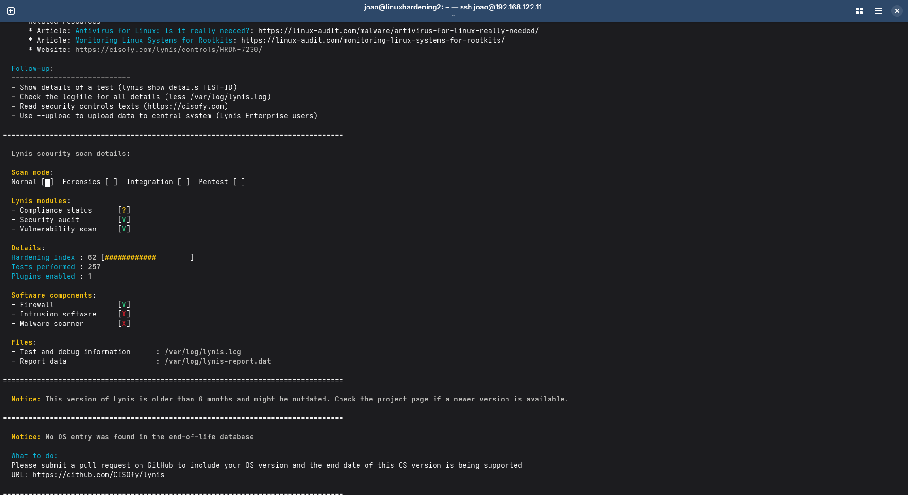

### Acesso SSH por password, porta 22

No início o acesso era feito com `ssh joao@192.168.122.6` e password, na porta 22 por omissão. É este o acesso que os bots tentam obter por força bruta.

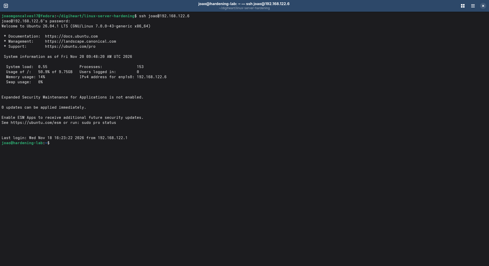

### Snapshot antes de alterar o sistema

```bash
sudo virsh snapshot-create-as hardening-lab limpo
```

**Porquê:** ao alterar o SSH e a firewall é fácil perder o acesso à máquina. Com um snapshot posso voltar atrás em segundos.

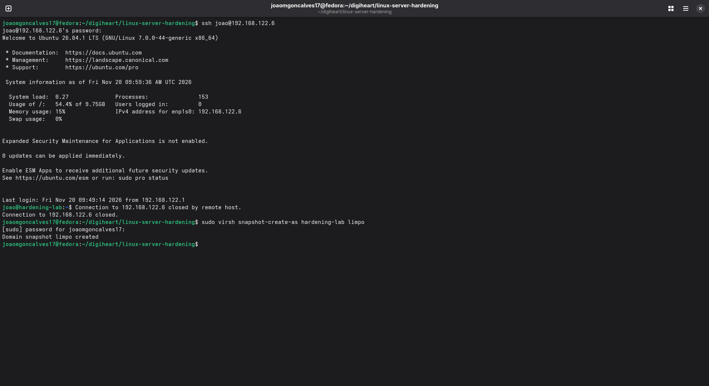

---

## 2. Checklist aplicada

### 2.1 Firewall (UFW)

```bash
sudo ufw default deny incoming    # bloqueia tudo o que entra, salvo exceções
sudo ufw default allow outgoing   # o servidor pode sair (updates, DNS, etc.)
sudo ufw allow 2222/tcp           # nova porta do SSH
sudo ufw allow 22/tcp             # temporário: não perder a sessão atual
sudo ufw enable
```

**Porquê:** o princípio é "negar por omissão". Só fica aberto o que tem de estar. A porta 22 ficou aberta temporariamente porque o `ss -tlnp` mostrava o `sshd` ainda a escutar na 22. Fechá-la antes de mudar a porta cortar-me-ia o acesso.

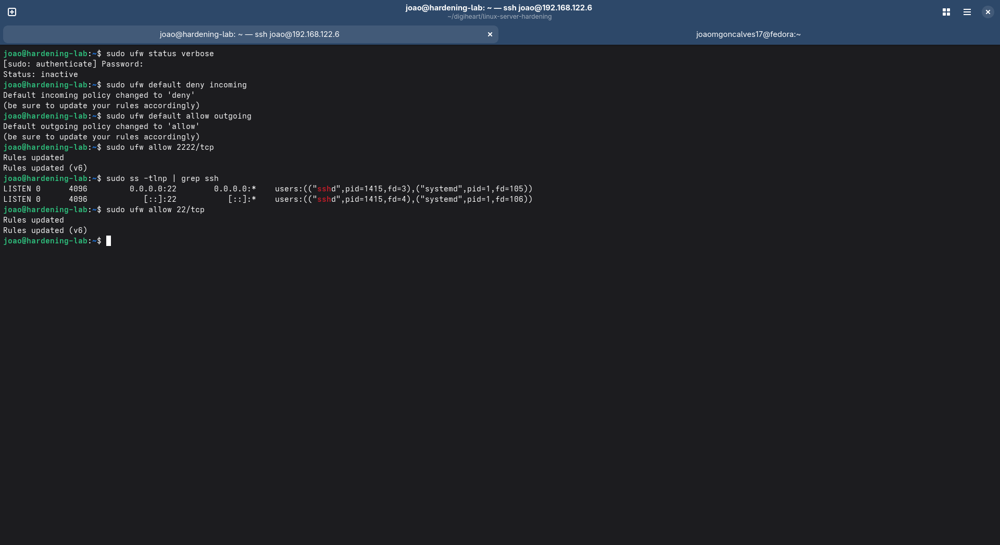

### 2.2 SSH: porta, root e autenticação

Em `/etc/ssh/sshd_config`:

```
Port 2222
PermitRootLogin no
PasswordAuthentication no
```

- **`Port 2222`**: tira o SSH da porta por omissão. Não é segurança a sério (um scan encontra-o), mas elimina a maior parte do ruído de bots automáticos.
- **`PermitRootLogin no`**: o root nunca entra diretamente. Entra-se com um utilizador normal e usa-se `sudo`, o que deixa rasto de quem fez o quê.
- **`PasswordAuthentication no`**: só entra quem tiver a chave privada (ed25519). Passwords podem ser adivinhadas por força bruta; uma chave não.

No Ubuntu recente o SSH é ativado por *socket* do systemd, por isso mudar a porta no ficheiro não chega. O próprio ficheiro avisa:

```bash
sudo systemctl daemon-reload
sudo systemctl restart ssh.socket
```

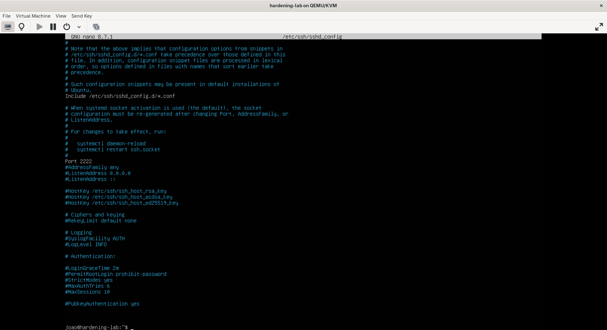

Com o SSH já a escutar na 2222, apaguei as regras da porta 22 (IPv4 e IPv6). No fim a firewall está ativa e ficam só duas regras: 2222/tcp em IPv4 e IPv6. Convém verificar com `ufw status numbered` depois de cada alteração.

```bash
sudo ufw status numbered
sudo ufw delete <n>
```

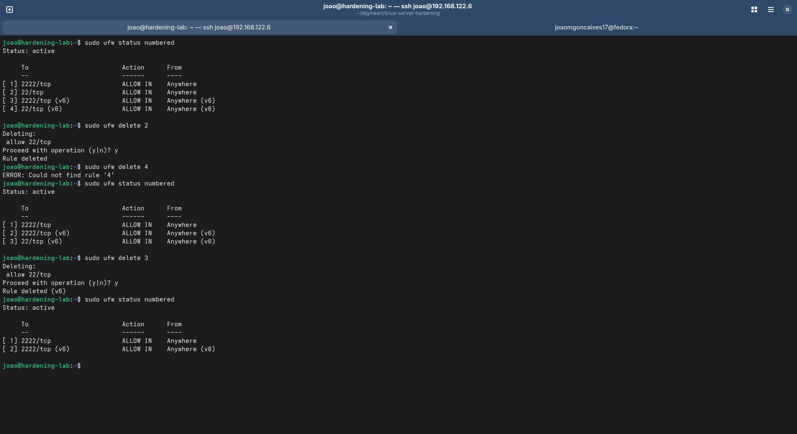

### 2.3 Fail2ban

```bash
sudo apt update && sudo apt install fail2ban -y
```

`/etc/fail2ban/jail.local`:

```ini
[DEFAULT]
bantime  = 5h
findtime = 10m
maxretry = 5
backend  = systemd

[sshd]
enabled = true
port    = 2222
```

- **`maxretry` / `findtime`**: 5 falhas em 10 minutos e o IP é banido.
- **`bantime = 5h`**: duração do bloqueio. Mais longo do que o valor por omissão para desencorajar bots.
- **`backend = systemd`**: o Ubuntu recente regista os logins no journal e não num ficheiro `auth.log`, por isso o fail2ban tem de ler do journal.
- **`port = 2222`**: o ban tem de bloquear a porta onde o SSH realmente está.
- Usa-se `jail.local` e não `jail.conf` porque o `.conf` é reescrito nas atualizações do pacote.

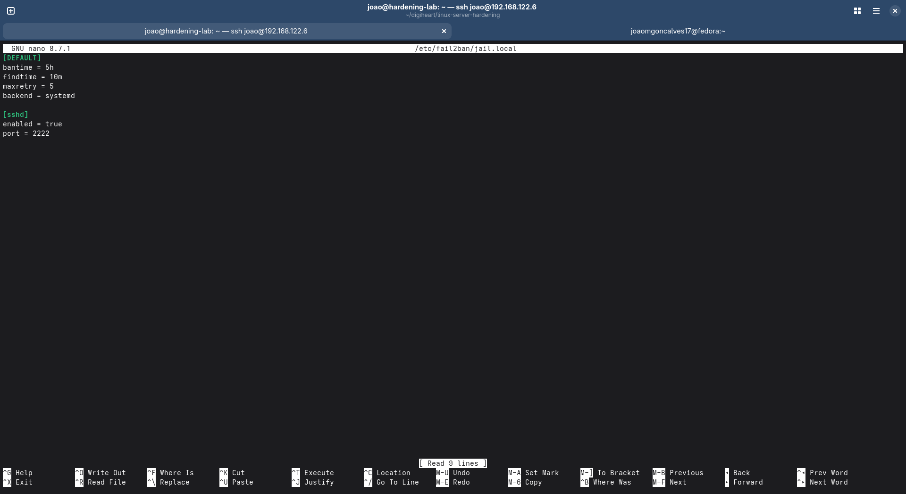

```bash
sudo systemctl enable --now fail2ban
sudo fail2ban-client status sshd
```

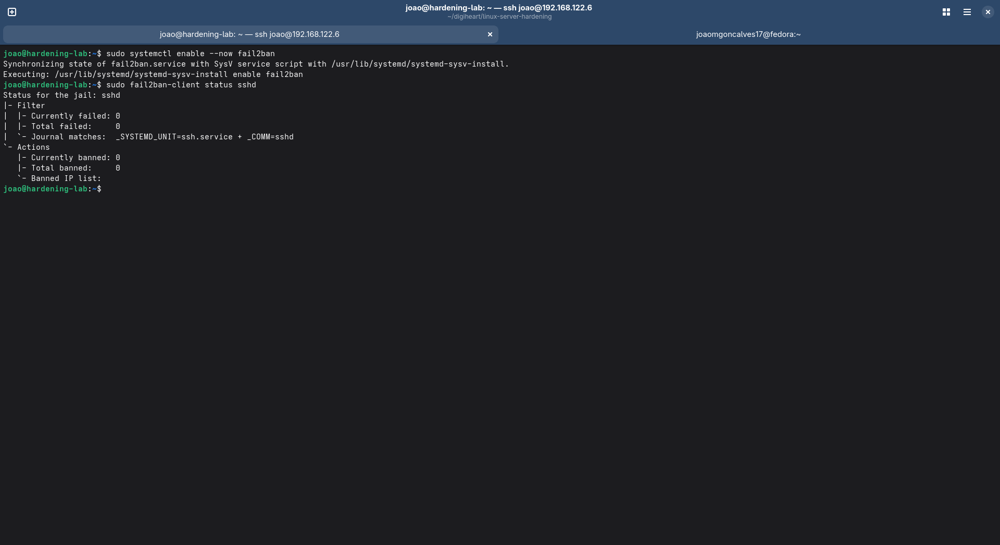

### 2.4 Atualizações automáticas de segurança

```bash
sudo dpkg-reconfigure -plow unattended-upgrades
cat /etc/apt/apt.conf.d/20auto-upgrades
sudo unattended-upgrade --dry-run --debug
```

**Porquê:** a maioria dos ataques bem-sucedidos explora vulnerabilidades já corrigidas, em servidores que ninguém atualizou. Assim os patches de segurança são aplicados sozinhos todos os dias. O `--dry-run` confirma que funciona sem instalar nada.

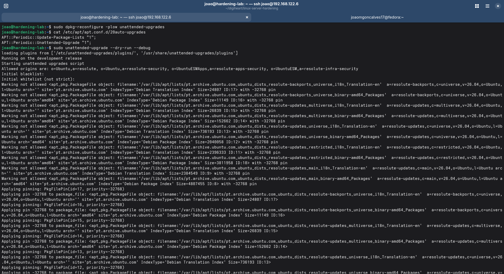

### 2.5 Validação do SSH

Antes de reiniciar o serviço, `sudo sshd -t` valida a configuração (sem output = sem erros). Um erro de sintaxe no `sshd_config` pode deixar o serviço sem arrancar e a máquina sem acesso remoto.

A prova final, a partir do host Fedora:

```bash
ssh -p 2222 joao@192.168.122.6                              # entra com chave
ssh -p 2222 -o PubkeyAuthentication=no joao@192.168.122.6   # força password
```

O primeiro entra sem pedir password. O segundo dá `Permission denied (publickey)`: o servidor nem oferece a opção de password.

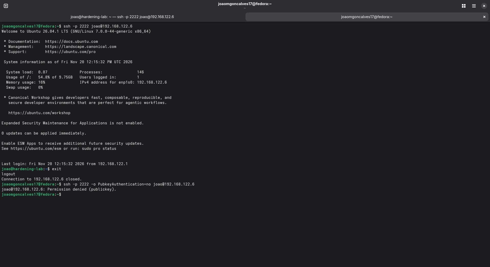

### Resultado após a checklist: 66

O índice subiu de **62 para 66** e "Intrusion software" passou de ✗ para ✓ (fail2ban).

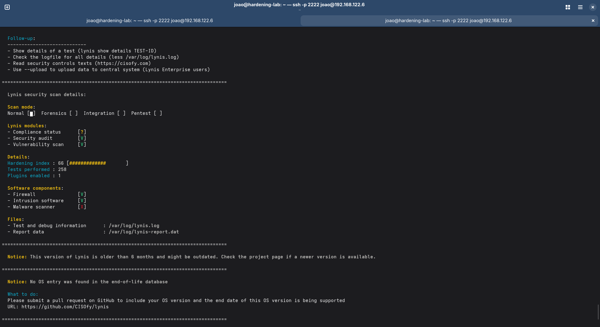

---

## 3. Extras

### 3.1 SSH mais apertado: `/etc/ssh/sshd_config.d/99-hardening.conf`

```
MaxAuthTries 3
MaxSessions 2
X11Forwarding no
AllowTcpForwarding no
AllowAgentForwarding no
TCPKeepAlive no
ClientAliveCountMax 2
LogLevel VERBOSE
AllowUsers joao
```

| Diretiva | O que faz |
|---|---|
| `MaxAuthTries 3` | Menos tentativas por ligação |
| `MaxSessions 2` | Limita sessões em simultâneo por ligação |
| `X11Forwarding no` | Desliga o reencaminhamento gráfico (não é preciso num servidor) |
| `AllowTcpForwarding no` | Impede usar o servidor como túnel para outras redes |
| `AllowAgentForwarding no` | Evita expor o agente de chaves a quem controle o servidor |
| `TCPKeepAlive no` + `ClientAliveCountMax 2` | Sessões mortas fecham mais depressa (keepalive pelo canal cifrado, não pelo TCP) |
| `LogLevel VERBOSE` | Regista a impressão digital da chave usada em cada login |
| `AllowUsers joao` | Só este utilizador pode entrar por SSH |

**Porquê um ficheiro separado:** os ficheiros em `sshd_config.d/` são incluídos pelo `sshd_config` principal, e assim as minhas alterações ficam isoladas e não são perdidas se o pacote atualizar o ficheiro principal.

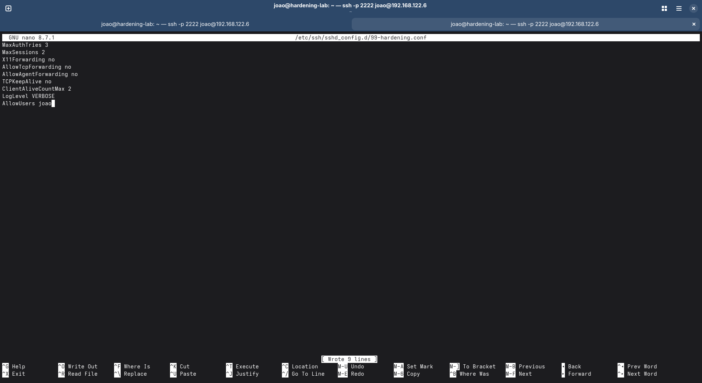

### 3.2 Pacotes de segurança e auditoria

- **rkhunter**: procura rootkits (é o que faz o "Malware scanner" passar a ✓).
- **auditd**: regista eventos do sistema ao nível do kernel (quem acedeu a quê).
- **libpam-tmpdir**: cada utilizador recebe o seu próprio diretório temporário.
- **apt-listchanges**: mostra o que muda antes de cada atualização.
- **debsums**: verifica se os ficheiros dos pacotes instalados foram alterados.

### 3.3 Outros

- **Banner legal** em `/etc/issue` e `/etc/issue.net`: aviso de acesso restrito antes do login.
- **Postfix em modo "Local only"**: o servidor de mail não aceita ligações de fora.

### Resultado final: 75

Índice **75**, 266 testes. Firewall, Intrusion software e Malware scanner todos a ✓.

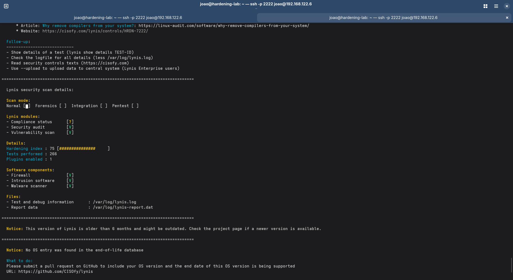

---

## 4. Análise dos resultados

**Porque é que a checklist só subiu 4 pontos (62 → 66)?**

O Lynis corre mais de 250 testes espalhados pelo sistema inteiro (kernel, partições, permissões, contas, pacotes, logging, etc.) e cada teste conta mais ou menos o mesmo. A checklist mexe sobretudo numa área (o acesso remoto), por isso pesa pouco no total.

Mas o índice não mede risco real. Na prática, desligar o login por password e o root, fechar todas as portas menos uma e banir quem tenta força bruta elimina os ataques mais comuns contra uma VPS exposta à Internet. São as medidas com mais impacto, mesmo valendo poucos pontos.

Os extras sobem mais o número (66 → 75) porque tocam em muitos testes pequenos diferentes (opções do SSH, ferramentas de auditoria, banner, mail).

**Conclusão:** o Lynis é útil para encontrar o que falta e para medir progresso, mas o objetivo não é maximizar o número. É reduzir a superfície de ataque.

---

## 5. Próximos passos

- Partições separadas para `/tmp`, `/var` e `/home`, com opções `noexec`, `nosuid`, `nodev`.
- Parâmetros de kernel com `sysctl` (por exemplo, proteção contra IP spoofing e redirecionamentos ICMP).
- Políticas de passwords (validade, complexidade) para contas locais.
- Remover compiladores (`gcc`, etc.) que não são precisos num servidor de produção.

---

## Estrutura

```
.
├── README.md
└── imagens/
    ├── 01-lynis-antes-62.png
    ├── 02-ssh-login-com-password-antes.png
    ├── 03-snapshot-vm-limpo.png
    ├── 04-ufw-politicas-e-regras.png
    ├── 05-sshd-config-porta-2222.png
    ├── 06-ufw-final-so-2222.png
    ├── 07-fail2ban-jail-local.png
    ├── 08-fail2ban-ativo.png
    ├── 09-unattended-upgrades.png
    ├── 10-ssh-chave-ok-password-negada.png
    ├── 11-lynis-checklist-66.png
    ├── 12-sshd-99-hardening-conf.png
    └── 13-lynis-extras-75.png
```
